# Cognita

Cognita is a small live-classroom app for courses that meet in real time.

An instructor builds a course and a class, a student joins with a short class key, and everyone
meets in one group call with a shared board, live polls and an attendance register that fills
itself. Between lessons, the community is where learners ask questions, form groups and work
through free and paid courses at their own pace.

Built with **Laravel 13**, **Inertia 3**, **React 19** and **Tailwind 4**. **LiveKit** carries
voice, screen share and board strokes; **PostgreSQL** keeps the record; **Redis** keeps live room
state; PDFs, photos and lesson files live in **private object storage**.

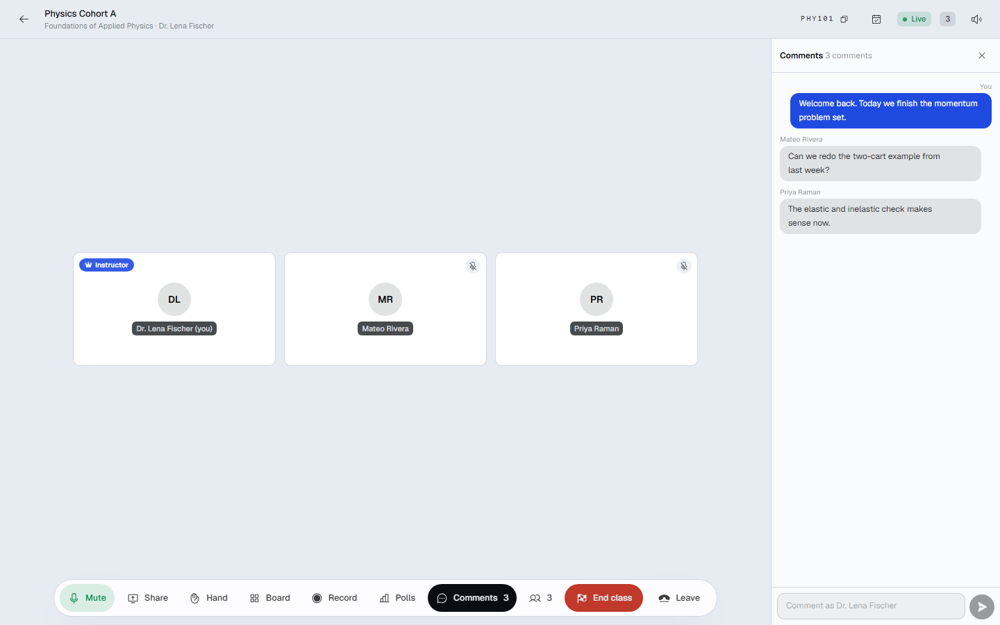

## At a glance

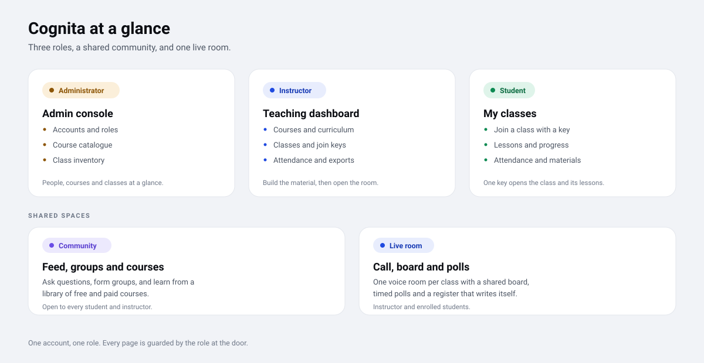

One account has one role: **administrator**, **instructor** or **student**. Signing up always
creates a student; an administrator can promote an instructor. Every page is guarded by role
middleware, so each person sees only the surface built for them. The community is the one place
students and instructors share.

## Screens

| Lobby | Live room |
| --- | --- |
| 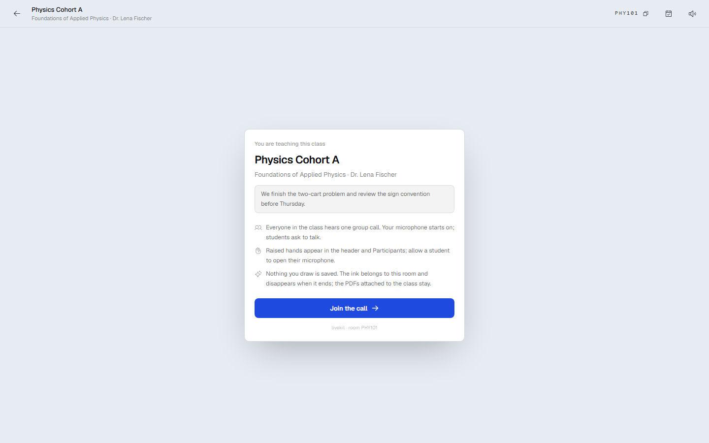 |  |
| **Lobby.** Who you are in the class, what the room expects, and one way in. | **Live room.** Participants, hand raising, comments and every call control. |
| 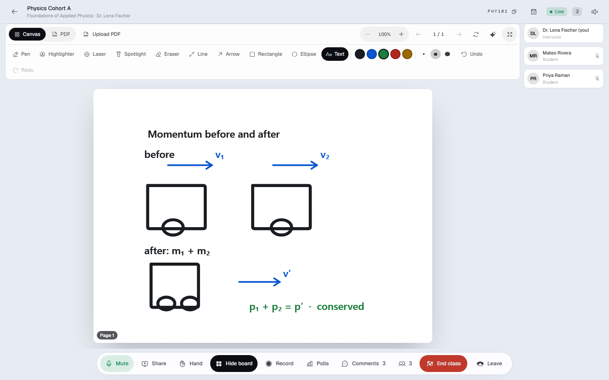 | 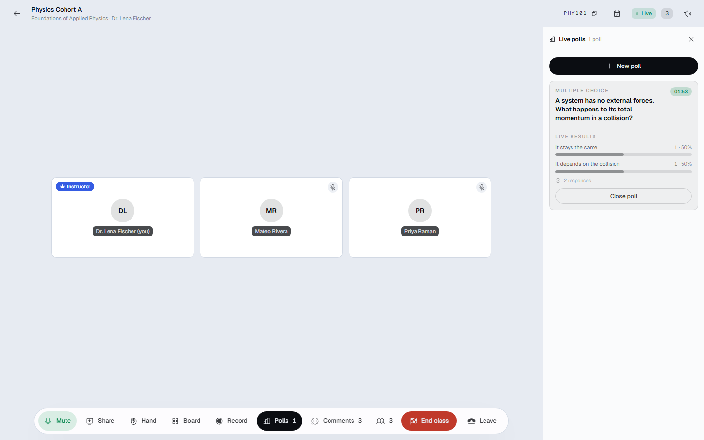 |
| **Shared board.** Canvas or PDF, handed to students from inside the room. | **Live polls.** Timed multiple-choice or open answers, counted live. |
| 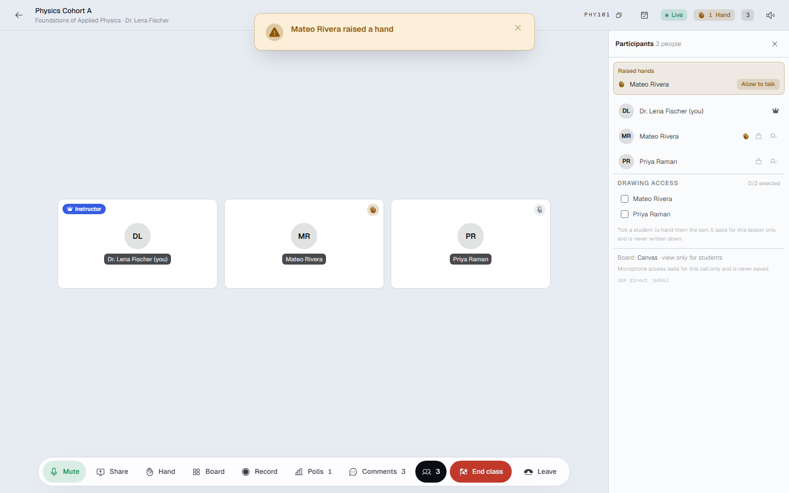 | 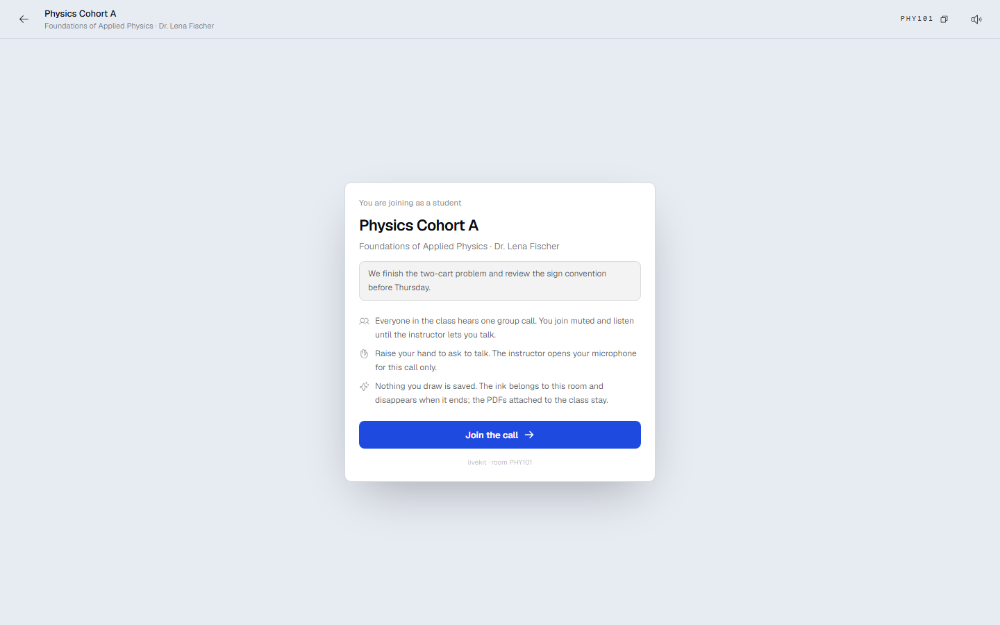 |
| **Participants.** Hands, microphones, drawing access and removal in one panel. | **Student lobby.** The same room, with the student's own rules. |

| Teaching | Learning |
| --- | --- |
| 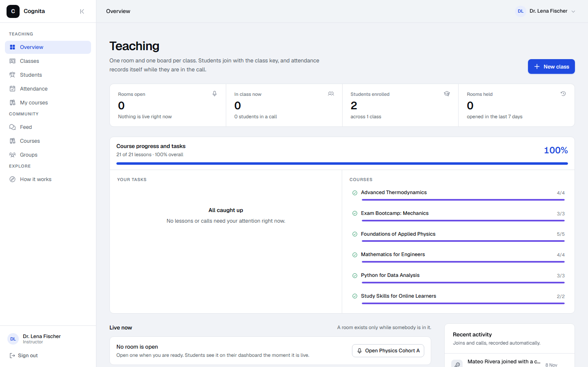 | 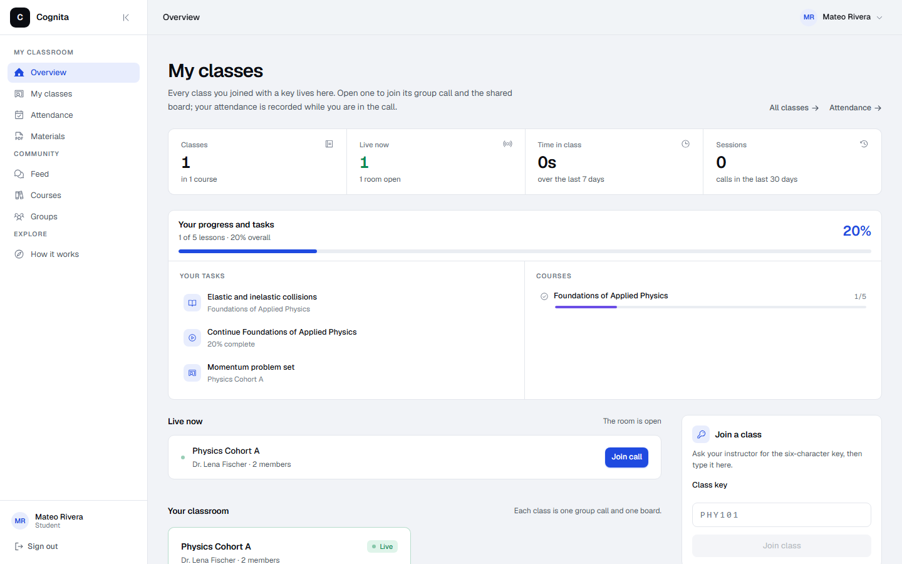 |
| **Teaching overview.** Open rooms, the roster and progress for every course you teach. | **Student overview.** Live rooms, tasks and progress, plus the class-key box. |
| 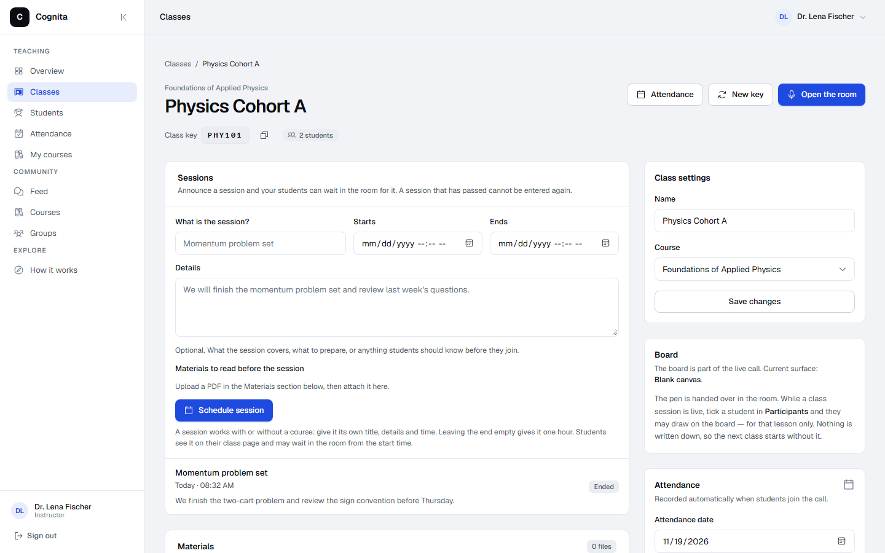 | 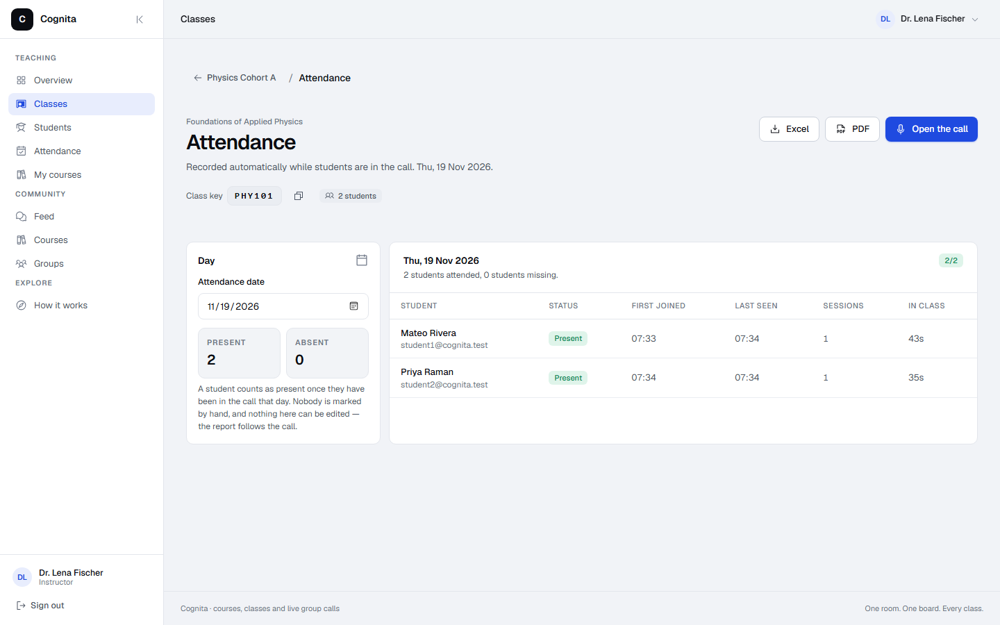 |
| **Class page.** Announce a session, rotate the key, open the room, read the register. | **Attendance.** Present, absent, first joined, last seen and time in class. |

| Community | Courses |
| --- | --- |
| 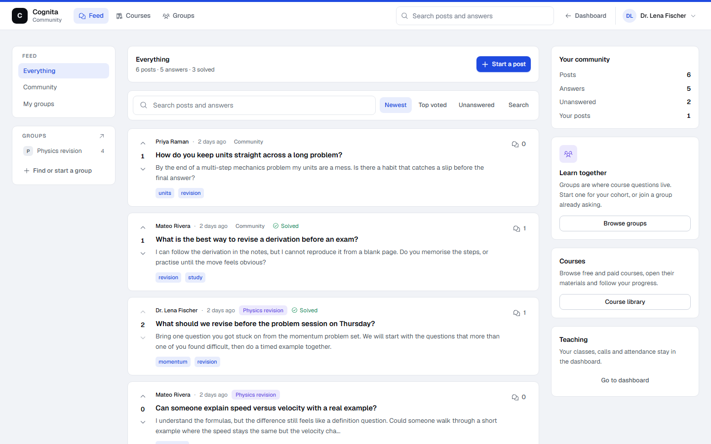 | 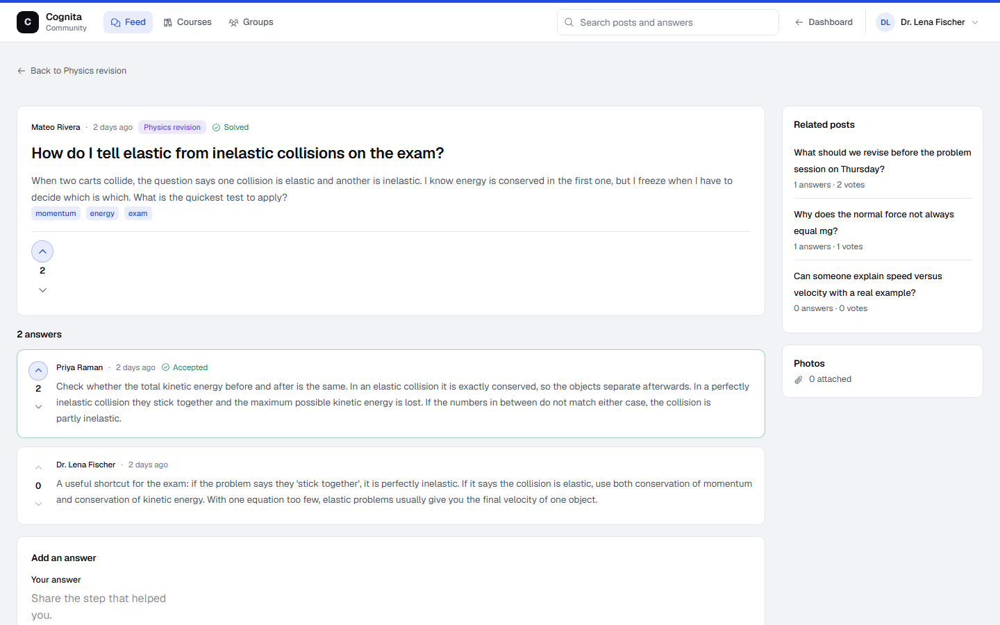 |
| **Feed.** Questions, tags, votes, accepted answers and group shortcuts. | **Answers.** One question with its answers, votes and related posts. |
| 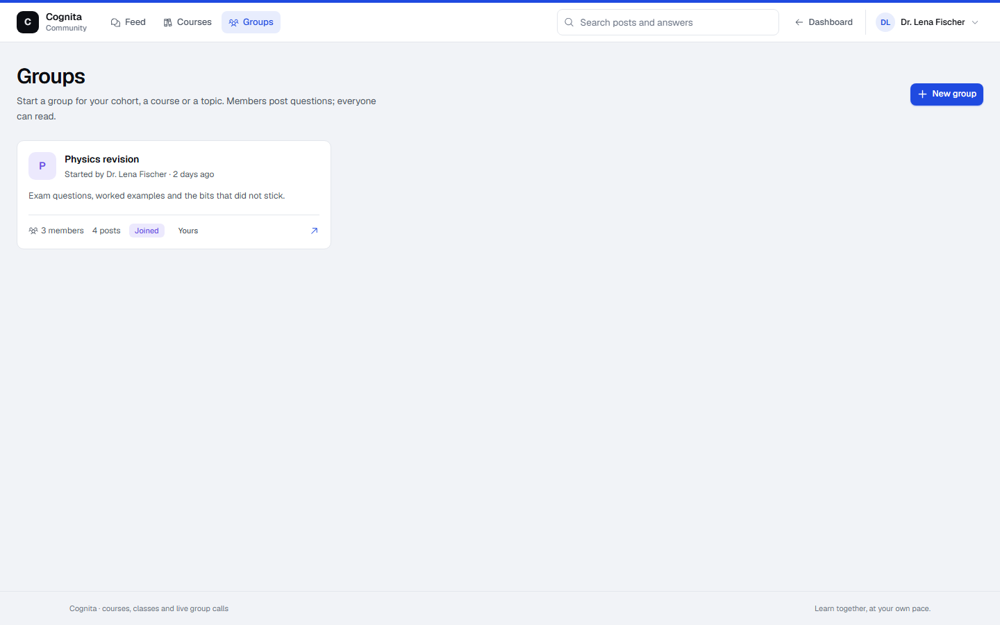 | 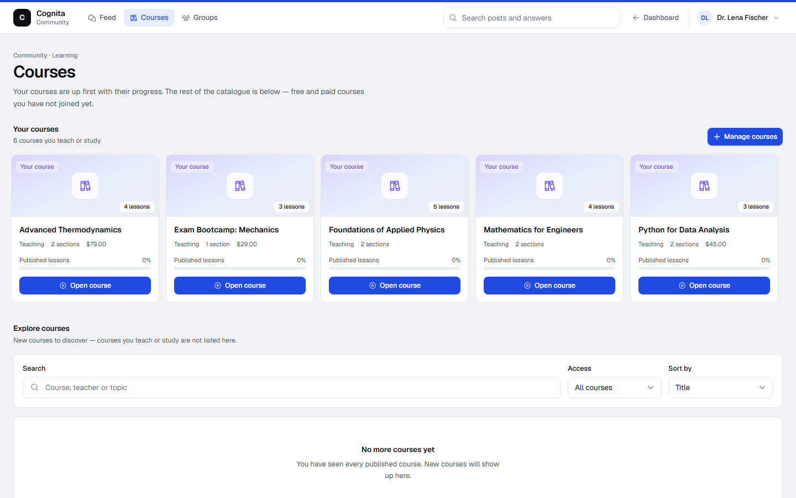 |
| **Groups.** Cohort and topic groups; members post, everyone reads. | **Courses.** Your courses first, then the free and paid catalogue. |

## What you can do

### Teach

- **Build a course.** Add sections and lessons (article, video or quiz), publish or keep the
  course in draft, and attach files to individual lessons. A course can be free, or paid with a
  price and payment instructions.
- **Run classes.** Create a class under a course — or with no course at all. Each class gets a
  six-character join key you can rotate at any time. The roster, join dates and payment state sit
  on one page.
- **Open the room.** Announce a session with a title, start time and window, join to open it, and
  press **End class** when it is over.
- **See who attended.** One row per student per session, with first joined, last seen, session
  count and time in class. Download the day's register as Excel or PDF.
- **Confirm payments.** In a paid course, a student reports that they have paid; you confirm it
  from the roster. Only your confirmation unlocks the live room and the course content.

### Learn

- **Join with a key.** Type the class key on the welcome page or under **My classes** — before or
  after signing in.
- **Work through a course.** Open lessons, watch uploaded videos or embeds, read notes, view PDFs
  and images, and mark lessons in progress or complete.
- **Know what is open.** Titles, descriptions and prices are visible to every signed-in learner.
  Lessons and files need a class membership; a paid course also needs the instructor's
  confirmation.
- **Keep your own record.** Your classes, recent sessions, attendance history and every file
  shared with your classes are collected in the dashboard.

### Learn together

- **A community feed.** Ask a question or start a discussion, to everyone or inside a group. Add
  tags, attach up to five photos, answer, vote both ways, and mark one answer as accepted.
- **Groups.** Any learner can start a group; anyone can join. Only members can post inside.
- **Courses in one library.** Your courses come first, the rest are there to explore, with
  free/paid filters and progress on everything you have joined.
- **Find the post.** Search across posts and answers (semantic when embeddings are configured,
  keyword otherwise), sort by newest, top voted or unanswered, and scope the feed to your groups.

### Meet in the room

- **One voice room per class.** The instructor opens it; students join muted and raise a hand to
  ask for the microphone. Screen sharing, short-lived comments and participant removal are built
  in. One account gets one live seat per class.
- **A shared board.** Present a PDF from the class library or a blank canvas. Pen, highlighter,
  laser, spotlight, eraser, line, arrow, rectangle, ellipse and text; personal undo/redo; pages;
  fullscreen. The instructor can hand the pen to individual students for that lesson only.
- **Polls that belong to the lesson.** Start a timed multiple-choice or open-answer poll from the
  call bar. Answers can change until the timer ends; counts and written answers update live.
- **Recording on your device.** The instructor can record the room — microphones plus the stage —
  to a local file. Nothing is uploaded.
- **Attendance that writes itself.** Joining starts a row, heartbeats keep it fresh, leaving
  closes it, and rejoining the same session adds to the same total instead of starting over.

## The life of a session

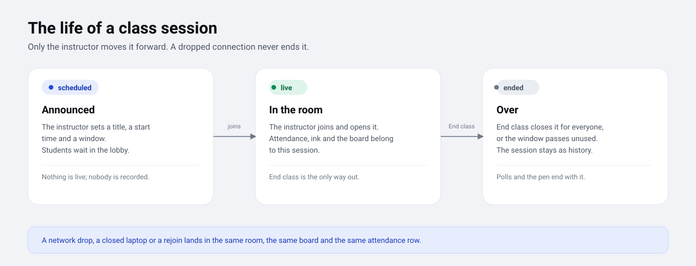

| State | What it means | Who may enter |
| --- | --- | --- |
| **Scheduled** | The instructor announced a title, a start time and a window. | Students wait in the lobby; nothing is live or recorded. |
| **Live** | The instructor opened the room. Attendance, ink and the board belong to this session. | The instructor and enrolled students. |
| **Ended** | The instructor pressed **End class**, or the window passed unused. | Nobody. A finished session stays as history and cannot be rejoined. |

A network drop, a closed laptop or a rejoin lands in the same room, the same board and the same
attendance row. Only **End class** closes a session.

## What is kept, and what deliberately is not

| Kept | Only while the room is open |
| --- | --- |
| Accounts, courses, sections, lessons, classes and memberships | Drawings — the board is a period of time, never a row in the database |
| Sessions, attendance totals and class PDFs | Chat comments — they travel over the call's data channel and vanish with it |
| Posts, answers, votes, groups and poll results | Microphone and drawing permissions — granted for this lesson, never saved |
| Payment state and paid-at timestamps | Recordings — written to the instructor's device, never uploaded |

Files are just as private: every PDF, photo and lesson file lives on the media disk (S3 in
production, MinIO or local disk in development) and is served through an access-checked route.
Nothing is written under `public/` and no file gets a public URL.

## How it runs

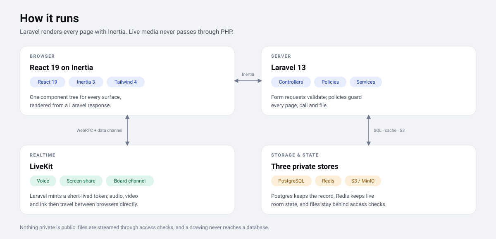

Laravel renders each page with Inertia, so the browser stays a single React app without a
separate API to maintain. For the call, Laravel mints a short-lived token and then gets out of
the way: voice, screen share and board strokes travel directly between browsers through LiveKit.

## Add a little class

1. Sign in as the instructor and create a course, then a class inside it — or create a class with
   no course at all.
2. Copy the six-character class key from the class page.
3. Sign in as a student in another browser and enter the key.
4. Join the call, open the board, upload a PDF or draw on the canvas, and hand the pen to a
   student from **Participants**.
5. Open a poll, ask a question in **Comments**, or press **Record** to keep a copy.
6. Press **End class** when the lesson is done, then read the register from the class page.

Handy shortcuts inside the call: `B` board, `F` fullscreen, `M` microphone, `H` hand, `P` polls,
`R` record (instructor), `Esc` leave fullscreen or close a panel.

## Run it locally

Requirements: **PHP 8.3+**, **Node 20+**, **Docker** (PostgreSQL, MinIO, Redis), and `openssl`
for the local HTTPS certificate.

```bash
# 1) from the repository root: database, object storage and shared cache
docker compose up -d db minio minio-mc redis

# 2) backend
cd cognita
cp .env.example .env          # the defaults already match docker compose
composer install
php artisan key:generate
php artisan migrate:fresh --seed
php artisan serve --host=0.0.0.0 --port=8000

# 3) frontend, second terminal
npm install
npm run dev                   # or: npm run build

# 4) call server, third terminal (from the repository root)
.dev/livekit.sh
```

Open <http://127.0.0.1:8000>. From a phone on the same Wi-Fi, open
`https://<this-machine-lan-ip>:8443` instead, so the browser allows the microphone. See
[the call server](#the-call-server) for what that script does.

### Seeded accounts

| Role | Email | Password |
| --- | --- | --- |
| Admin | `admin@cognita.test` | `password` |
| Instructor | `instructor@cognita.test` | `password` |
| Student | `student1@cognita.test` | `password` |
| Student | `student2@cognita.test` | `password` |
| Student | `student3@cognita.test` | `password` |

The seed also creates the *Physics Cohort A* class (key **`PHY101`**), a mixed catalogue of free
and paid courses with sections and lessons, and a Physics revision group with community posts.

## The call server

Two connections must both work: the **signal** WebSocket on 7880 (TCP) and the **media** path on
7882 (UDP), with TURN on 3478 as the fallback. A page that says *Joining…* and then *Reconnecting*
is almost always the second one.

```bash
.dev/livekit.sh              # start everything, machine + LAN
.dev/livekit.sh status       # what is running, on which address
.dev/livekit.sh check        # end-to-end: signal, TCP fallback, UDP media, HTTPS front
.dev/livekit.sh down         # stop

.dev/livekit.sh --direct     # skip the Windows relay: this machine only
.dev/livekit.sh --no-tls     # skip the HTTPS front
```

Every start re-detects the machine's current LAN address and rewrites everything that depends on
it, so nothing has to be edited by hand. The app itself never stores the call address: the
provider derives it from the request, so a laptop at `localhost`, a phone at a LAN address and a
hosted server all get an address they can reach.

| Where | Address | Microphone |
| --- | --- | --- |
| This machine | `http://localhost:8000` | yes |
| This machine, phone-equivalent | `https://localhost:8443` | yes |
| Phone / other device | `https://<lan-ip>:8443` | yes, after accepting the certificate |
| Phone on plain HTTP | `http://<lan-ip>:8000` | no — hears only, the browser blocks capture |

On Windows, run the firewall setup once from an elevated PowerShell:

```powershell
.\.dev\lan-forward\setup-windows.ps1
```

Verify a call without guessing: `.dev/livekit.sh check`, `php artisan realtime:check`, or the
**Check connection** button in the call lobby, which reports configuration, signal, credentials,
UDP media and the media path this browser actually chose.

The call server is replaceable. `App\Contracts\RealtimeProvider` is the whole contract — a driver
name, a signal URL, a grant, participant removal and a diagnostic report. LiveKit is one
implementation; to use another, write the class, register it in `config/services.php`, and set
`REALTIME_DRIVER`. The browser mirrors the idea with a `CallTransport` in `resources/js/realtime/`
and falls back to a tab-local preview when no server is configured.

### If the call will not start

1. **Signal fails** — LiveKit is not running. Start it with `.dev/livekit.sh`, then run
   `.dev/livekit.sh check`.
2. **Media fails** — UDP 3478 is being dropped. On Windows rerun `setup-windows.ps1` elevated; on
   another network, check the router. Carrier-grade NAT on mobile data often blocks inbound UDP.
3. **The origin is not secure** — open the HTTPS address the call page links to. The board still
   works on plain HTTP; only capture needs a secure origin.
4. **Two tabs on one account** — each tab gets its own call identity, so they no longer kick each
   other out. One account still gets one live seat per class.

## Under the hood

| Layer | Choices |
| --- | --- |
| Backend | Laravel 13 · PHP 8.3+ · one migration for the whole schema · policies for every model |
| Frontend | React 19 · Inertia 3 · Tailwind 4 · Geist · TypeScript |
| Calls | LiveKit (swappable provider) · one seat per account · `LocalTransport` fallback for preview |
| Data | PostgreSQL · Redis for live room state · S3-compatible object storage for files |
| Quality | PHPUnit feature and unit tests · `tsc --noEmit` · Pint |

```
cognita/
├── app/
│   ├── Contracts/        RealtimeProvider — what a call server must do
│   ├── Enums/            roles, statuses, lesson types, payment states
│   ├── Http/             controllers, form requests and policy wiring
│   ├── Models/           one model per table
│   ├── Policies/         one policy per model
│   ├── Services/         calls, board, attendance, payments, permissions
│   └── Support/          small shared helpers
├── database/
│   ├── migrations/       one file: the whole schema
│   ├── factories/        one per model
│   └── seeders/          demo accounts, a class, courses and community posts
├── resources/js/
│   ├── components/       UI, call, board, community and dashboard pieces
│   ├── hooks/            useCall, useBoard, usePolls, usePresence, useFullscreen
│   ├── layouts/          AppShell, DashboardShell, CommunityShell, GuestShell
│   ├── pages/            Welcome, Auth, Student, Instructor, Admin, Community, LiveCall, Profile
│   └── realtime/         transport contract plus LiveKit and local adapters
├── routes/               one file per surface
└── tests/                Unit + Feature
```

## Tests

```bash
php artisan test --compact                # from cognita/
npm run typecheck                         # from cognita/
.dev/acceptance.sh                        # schema, phpunit, tsc, production build
.dev/ui-smoke.sh http://127.0.0.1:8000    # HTTP smoke test across the three roles
```

The suite covers authentication and role boundaries, the class-key door, course and class
management, paid-access gating, curriculum and files, the board and call permissions, one-seat
call locking, polls, attendance, community groups, post isolation, voting, accepted answers,
search and media storage.
