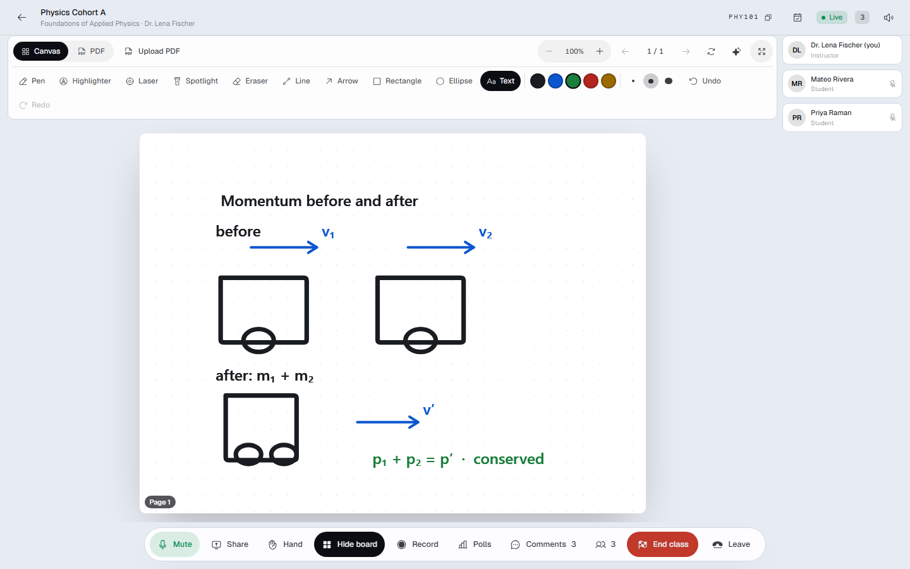

# Cognita (application)

The Laravel + Inertia application for Cognita. Setup, features, architecture, roles and tests
are documented once, in the repository root README: [../README.md](../README.md).



## Quick reference

```bash
php artisan migrate:fresh --seed   # whole schema + demo accounts + PHY101 class
php artisan serve --port=8000      # app
npm run dev                        # Vite dev server (second terminal)
npm run typecheck                  # tsc --noEmit
npm run build                      # production assets
php artisan test --compact         # PHPUnit
```

The call server runs from the repository root: `.dev/livekit.sh` (see the root README for
status, checks and the Windows setup).

## Layout

- `app/Models`, `app/Http/Controllers`, `app/Http/Requests`, `app/Services`, `app/Policies`,
  `app/Enums` — the conventional Laravel layout; controllers are grouped in `Instructor/`,
  `Student/` and `Admin/` subfolders
- `resources/js/layouts` — `DashboardShell` (classes, calls, attendance, tasks and progress) and
  `CommunityShell` (feed, courses, groups); `AppShell` serves admin, `GuestShell` sign-in, and
  the live call is deliberately bare
- `resources/js/pages` — `Student`, `Instructor`, `Admin`, `Community`, `LiveCall`, `Profile`,
  `Auth` and `Welcome`
- `resources/js` — `components/`, `hooks/`, `lib/`, `realtime/`, `types/`
- `routes/` — `web.php` plus one file per surface: `admin.php`, `instructor.php`, `student.php`,
  `questions.php` (feed) and `community.php` (courses, groups)
- `tests/` — `Unit` + `Feature`
